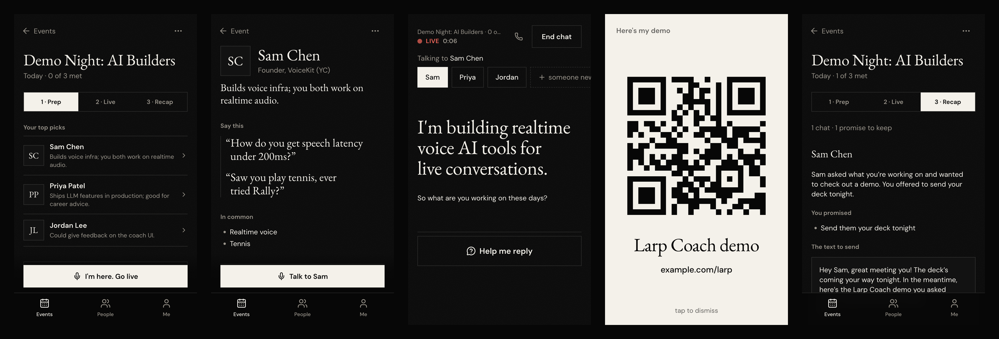
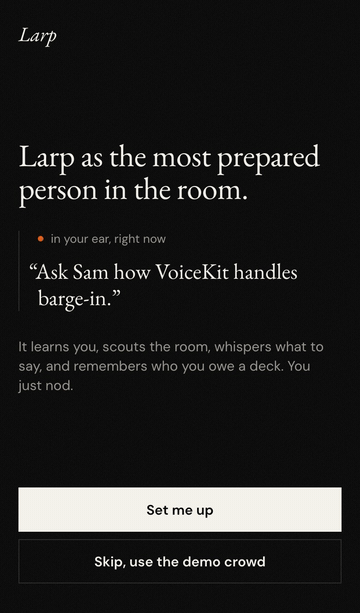
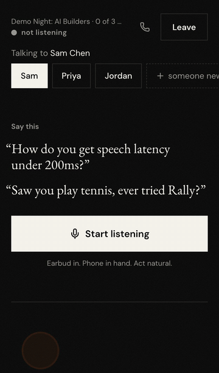
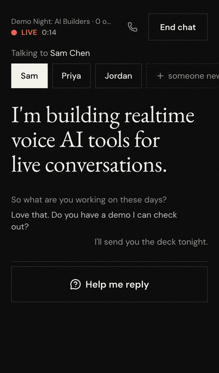
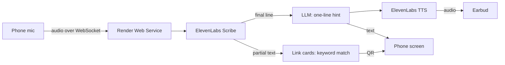

# Larp

**Larp as the most prepared person in the room.**

An AI earpiece for networking events. It scouts who's there, whispers what to say mid-conversation, and writes your follow-ups.



## The problem

- You walk in knowing nobody and nothing about them.
- Someone asks what you do and you blank.
- You promise to send the deck. You never send the deck.

## How it works

| 1 · Before: scout the room | 2 · During: it whispers | 3 · Bail: fake a call |
|:---:|:---:|:---:|
|  |  |  |
| Ranks who's worth meeting. Builds a dossier with openers. | Hears the question, shows + speaks a one-line answer. Asked for your demo? QR card. | Say *"is that my phone?"* and Mom calls. Escape granted. |

<sub>GIFs are real app captures. The spoken lines are typed in, since a headless browser can't talk.</sub>

## Features

| Stage | Feature | What it does |
|---|---|---|
| Before | **Knows you** | Resume PDF + links (GitHub, portfolio) → your profile. Every hint draws on it. |
| Before | **Knows them** | Paste a Luma link, a guest-list screenshot, or names. Ranks guests by overlap with you. |
| Before | **Dossiers** | Web research per person → what they do, what you share, openers to use. |
| During | **Whispers** | Listens through the phone mic. When you're asked something, a short answer plays in your earbud and shows on screen. |
| During | **Link cards** | "Do you have a demo?" → a full-screen QR card, before they finish the sentence. No LLM on this path. |
| During | **Catches names** | Talking to a stranger or a group? It hears "I'm Mati" and tags them. Names snap to the guest list. |
| During | **Help me reply** | Blanked? Tap the button (or your earbud's play button) to force a hint. |
| During | **Escape call** | Code phrase or phone icon → fake incoming call from Mom, with a real voice. |
| After | **Recap** | Per chat: summary, what you promised, and a drafted text to send. |
| After | **Nudges** | Hourly cron flags promises you haven't kept yet. |

## Why it's a larp

Hints don't just remind you of facts. They make you sound like the most impressive version of yourself: confident, specific, slightly inflated. You nod and repeat.

## Built with

**ElevenLabs: the ears and the voice**
- **Scribe v2 Realtime** streams the conversation to text. Biased with keyterms so attendee names are spelled right.
- **Streaming TTS** speaks each hint into your earbud.
- **Pre-baked voice** for Mom's escape call, so it plays instantly.

**Render: the whole product in one [`render.yaml`](render.yaml) Blueprint**

| Service | Job |
|---|---|
| Static Site | The phone web app (PWA) |
| Web Service | REST API + live WebSocket (mic audio in, whispers out) |
| Background Worker | Slow work off the live path: profile building, ranking, dossiers |
| Key Value | Job queue between API and worker |
| Postgres | Profiles, events, people, conversations, follow-ups |
| Cron Job | Hourly follow-up nudges |

**Everything else:** TypeScript end to end · React + Vite + Tailwind · LLMs behind one provider-agnostic module (Baseten, OpenAI) · Exa web search for dossier facts.

## The live path



Slow thinking (research, ranking, dossiers) happens before the event, on the worker. The live path only does speech → one short LLM call → speech.

## Run it locally

```bash
npm install
npm run dev        # web on :5173, api on :3000
```

Works with no keys, no database, no Redis: stubs, an in-memory store, and inline jobs. Copy `.env.example` to `.env` to turn on the real services.

```bash
npm run sim                                  # scripted conversation: hints + link cards with timings
npm test && npm run typecheck                # contract + live pipeline tests
node scripts/readme-media.mjs <web> <api>    # regenerate the GIFs above
```

## Layout

```
shared/   contracts: data models, REST routes, live protocol, demo fixtures
server/   API + WebSocket, background worker, cron (one package, three entrypoints)
web/      phone web app (Vite + React + Tailwind)
scripts/  dev, smoke, and screenshot helpers
docs/     product vision, build plan, how the pieces connect
```

Team docs: [vision](docs/brainstorm.md) · [plan](docs/plan.md) · [integration rules](docs/integration.md) · [judging rubric](docs/RUBRIC.md)
